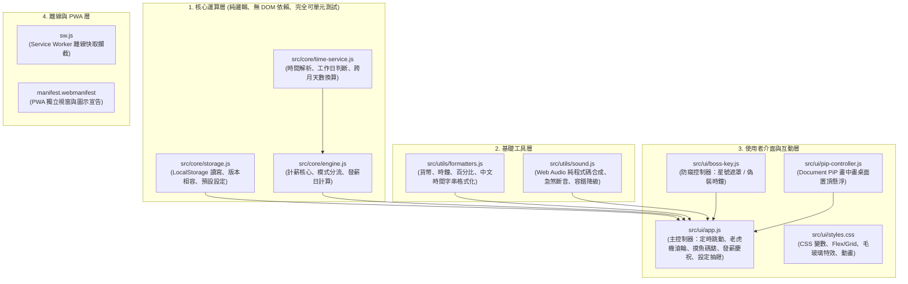

# 🏛️ 薪資時鐘 (Salary Clock) - 系統架構文件 (Architecture)

本文件詳細闡明薪資時鐘的系統模組切分、職責邊界、資料流動架構以及核心狀態管理原則。

---

## 1. 系統整體架構圖

系統遵循嚴格的**關注點分離 (Separation of Concerns)** 原則，將整體應用劃分為「核心運算層 (Core)」、「工具函式層 (Utils)」與「使用者互動展示層 (UI)」：



---

## 2. 檔案目錄與模組職責對照表

```
salary-clock/
├── index.html               # 核心 HTML5 結構、SVG 圖示、抽屜設定、PiP HUD 樣板
├── manifest.webmanifest     # PWA 配置，宣告獨立視窗 (display: standalone) 與 App 圖示
├── sw.js                    # Service Worker，提供靜態資源離線快取與秒開體驗
├── icons/
│   └── icon.svg             # PWA 向量圖示 (金幣時鐘造型)
├── src/
│   ├── core/
│   │   ├── engine.js        # 核心計薪引擎：模式分流、進度比例與發薪日倒數計算
│   │   ├── time-service.js  # 時間服務：平閏年天數、跨月常規天數安全折算、淨工時排除
│   │   └── storage.js       # 本機持久化：localStorage 存取與預設組態管理
│   ├── utils/
│   │   ├── formatters.js    # 格式化器：貨幣數值、碼錶、中文時分秒與百分比格式化
│   │   └── sound.js         # 音訊合成器：Web Audio 純程式碼金幣與發薪賀彩音效
│   └── ui/
│       ├── boss-key.js      # 老闆鍵控制器：管理遮罩偽裝狀態與全域快速鍵
│       ├── pip-controller.js# Document PiP 控制器：建立與同步獨立懸浮桌面 HUD
│       ├── app.js           # 主應用程式：生命週期、DOM 綁定、滾輪動畫、摸魚碼錶、金幣雨
│       └── styles.css       # 完整樣式：深色主題、響應式斷點、老虎機滾輪、摸魚戰報彈窗
├── docs/                    # 完整架構、設計邏輯與技術棧文件
└── test/
    └── engine.test.mjs      # 完整單元測試套件 (236+ 項測試)
```

---

## 3. 模組詳細職責說明

### 3.1 核心運算層 (`src/core/`)
- **`engine.js`**：
  - 核心入口 `calculateSalary(config, now)`。
  - 支援「工作日模式 (`calculateWorkdayMode`)」與「連續制模式 (`calculateContinuousMode`)」。
  - 整合發薪日倒數計算 `calculatePaydayCountdown(now, payday)`。
  - 內建 LRU/單一記憶快取機制 (`clearEngineCache`)，在每秒或微秒高頻呼叫時降低垃圾回收 (GC) 負擔。
- **`time-service.js`**：
  - 精確計算當月天數 `getMonthDays(year, month)`（自動處理閏年 2 月 29 天）。
  - `getWeekWorkDaysInfo` 實作跨月首週工作天安全計算，區分當月有效天數與常態整週天數，防止跨月時短週導致每週基準縮水。
  - `calculateWorkSeconds` 依據上下班時間精確折算淨工作秒數，並自動扣除午休時間。
- **`storage.js`**：
  - 封裝 `loadConfig()` 與 `saveConfig()`。
  - 定義 `DEFAULT_CONFIG`（包含薪資模式、工時、發薪日、幣別、小數點位數、防窺方式、音效預設靜音等）。

### 3.2 基礎工具層 (`src/utils/`)
- **`formatters.js`**：
  - `formatCurrency(val, symbol, decimals, thousands)`：支援千分位與自訂小數點位數。
  - `formatStopwatch(totalSeconds)`：格式化為 `MM:SS` 碼錶格式。
  - `formatDurationChinese(totalSeconds)`：格式化為「X 時 Y 分 Z 秒」親切中文格式。
- **`sound.js`**：
  - 懶加載 `AudioContext`，並在首次使用者互動後自動 resume。
  - `playKaChingSound()`：以正弦波與三角波雙震盪器合成清脆金幣進帳聲。
  - `playPaydayFanfare()`：以 4 重上行琶音合成發薪歡呼音效。
  - `stopAllSounds()`：在啟動防窺、關閉彈窗或視窗失焦時立時切斷聲音，保證辦公室安靜。

### 3.3 使用者介面層 (`src/ui/`)
- **`boss-key.js`**：
  - 管理 `isDisguised` 防窺狀態。
  - 支援兩種偽裝模式：`mask`（星號遮蔽金額）與 `clock`（即時偽裝為普通數位時鐘）。
- **`pip-controller.js`**：
  - 封裝 Chrome/Edge 原生 `window.documentPictureInPicture` API。
  - 動態複製主畫面的樣式表至 PiP 視窗，並渲染獨立小 HUD。
- **`app.js`**：
  - 應用核心中樞，統一協調時間更新迴圈 (`requestAnimationFrame` / `setInterval`)。
  - 實作 4 位數老虎機機械滾輪垂直位移算法。
  - 實作帶薪摸魚即時碼錶（開始/結束/戰報結算/睡眠防漂移）。
  - 實作發薪日 Canvas 粒子金幣雨與點擊回味重播邏輯。
  - 實作設定抽屜 (Drawer) 開闔與鍵盤無障礙焦點陷阱 (Focus Trap)。

---

## 4. 狀態管理原則 (State Architecture)

本專案將狀態嚴格區分為兩大類：

| 狀態類別 | 範例 | 儲存介質 | 處理原則 |
| :--- | :--- | :--- | :--- |
| **持久設定 (Persistent Config)** | 月薪、上班時間、發薪日、幣別、音效偏好 | `localStorage` | 透過 `storage.js` 統一管理，變更時寫入本機，頁面重整自動還原。 |
| **揮發性暫存狀態 (Volatile State)** | 摸魚開始時間、摸魚進行中標記、發薪慶祝動畫粒子 | **純記憶體 (RAM)** | **絕不寫入 localStorage**。遵循「隨開即用、零儲存負擔、純當下爽感」原則，避免遺留過期快取垃圾。 |
